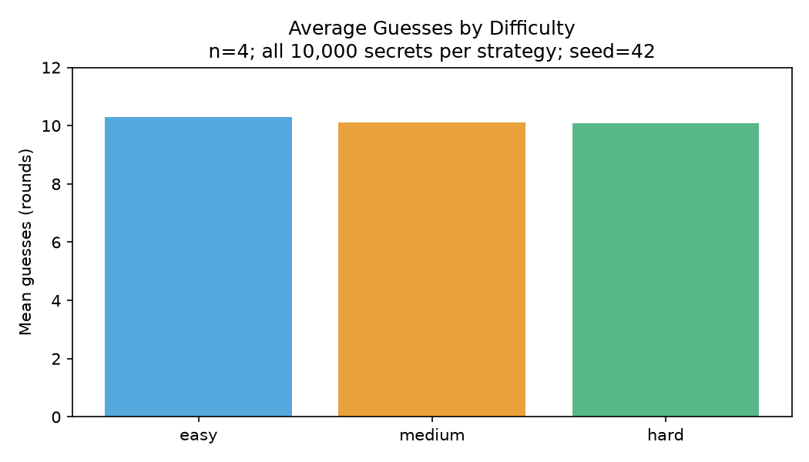
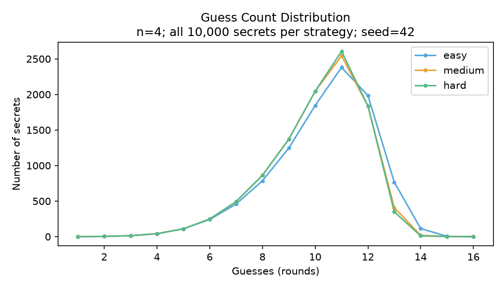
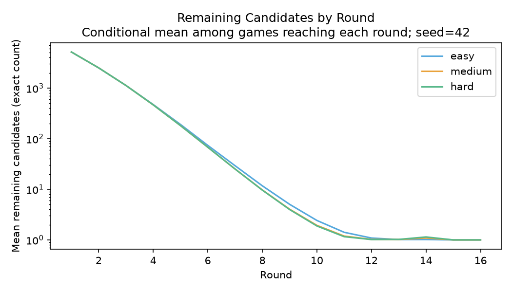
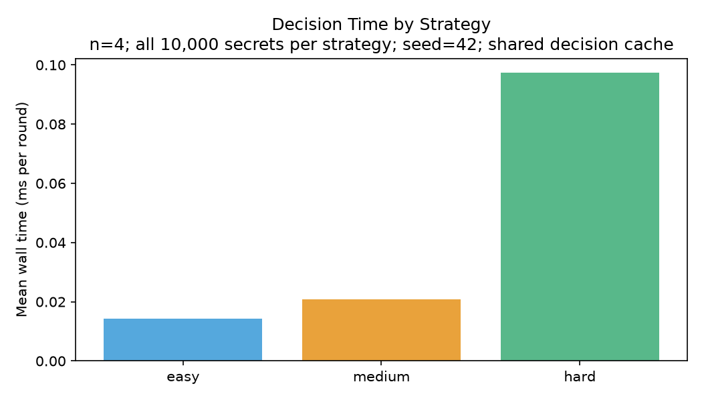

# CodeDuel — Human vs AI Code-Breaking Game

CodeDuel is a Python human-versus-AI code-breaking game comparing random,
heuristic and information-theoretic search under strict positional constraints.
The desktop application separates game state, secret storage, reasoning and UI.

**Provenance:** this automatic-feedback edition is a **reconstruction**, not a
recovered original snapshot. The available source was the later manual-feedback
edition. See [provenance](docs/provenance.md). No original source or Git history
was silently overwritten.

## Demo and features

- Four digits; repeated digits and leading zeros are valid.
- Independent fixed secrets; the engine scores both sides automatically.
- Both guesses are locked before scoring; simultaneous wins are draws.
- Easy, Medium and Hard always submit an unguessed, history-consistent candidate.
- Persistent scrollable round histories, measured strategy diagnostics and results.
- English / Simplified Chinese UI; masked human-secret entry with explicit reveal.
- Background reasoning with main-thread-only Tk updates.

The actual GUI flow has been tested in a desktop session. Native screenshot
capture failed in this environment; **no synthetic screenshots are presented**.
Run `python -m scripts.demo --stage game --language en` for a reproducible real
GUI scene, or `--stage result --language zh` for a Chinese result scene.

## How the game works

Each secret is a four-character string from `0000` to `9999`. Feedback is only
`sum(secret[i] == guess[i])`; misplaced matches do not count. Every round the
human submits a guess, the AI chooses using earlier feedback, and the engine
scores both. Even a human success does not skip the AI's same-round chance.
Secrets and difficulty cannot change during a game. The human never enters a
manual score in this edition.

## AI strategies

| Strategy | Decision rule |
|---|---|
| Easy | Uniform random choice from unguessed legal candidates |
| Medium | Up to 50 legal guesses and 70 answer samples; minimize estimated expected remaining size; randomize within 8% of the best score |
| Hard | Up to 500 legal guesses and 1500 answers; maximize Shannon entropy, then minimize largest feedback bucket within 0.02 bit; exact distributions when <=250 candidates |

At an unconstrained start all guesses have equal feedback distributions, so a
random legal opening avoids pointless scoring. Diagnostics explicitly show
when no distribution was evaluated. Hard is a candidate-constrained one-step
heuristic, **not a globally optimal decision tree**. Parameters live in
`code_duel/strategies.py::StrategyConfig`.

## Architecture and correctness

`rules.py` owns scoring; `solver.py` validates the entire immutable history;
`strategies.py` sees only a Solver; `engine.py` privately stores both secrets;
`gui.py` communicates with a worker through a queue. `simulation.py` scores a
known secret outside the strategy API. Python private names provide architectural
separation, not protection against malicious introspection.

The solver/strategy/scoring components share an explicit lineage with Solver
Lab. The GUI has a fixed edition flag, while each repository has its own engine,
entry point, tests, package metadata and independent release. The automatic
engine always uses length four; variable-length constraint utilities are shared
and separately tested, not part of the game rules.

## Reproduced benchmark

| Strategy | Secrets | Mean guesses | Median | P95 | Worst | Invalid | Failed |
|---|---:|---:|---:|---:|---:|---:|---:|
| easy | 10000 | 10.3033 | 11.0 | 13 | 16 | 0 | 0 |
| medium | 10000 | 10.1034 | 10.0 | 12 | 16 | 0 | 0 |
| hard | 10000 | 10.0880 | 10.0 | 12 | 16 | 0 | 0 |

Full four-digit space, seed 42, version 0.1.0. Total batch runtime:
**25.22 s** on macOS-26.5.2-arm64-arm-64bit-Mach-O, Python 3.14.6.
All 30,000 runs completed. Measurements are recorded with their actual UTC
execution timestamps in the JSON reports (local date: 2026-11-07).






Independent 1000-secret samples, same seed shared across strategies:

| Seed | Easy mean | Medium mean | Hard mean |
|---|---:|---:|---:|
| 7 | 10.174 | 10.103 | 10.092 |
| 101 | 10.264 | 10.049 | 10.109 |

Hard's advantage is small and **does not persist for every seed**. Do not infer
statistical superiority from the full-space mean for one randomized policy.
The benchmark caches decisions at shared histories; timing is cache-aware,
not a cold-start latency promise. Conditional candidate curves only average
games that reached each round. Raw per-game compressed CSV and reports are checked in.

```sh
python -m code_duel.simulation --all --seeds 42 --output benchmarks/results/exhaustive
python -m code_duel.simulation --count 1000 --seeds 7 101 --output benchmarks/results/replication
python -m scripts.plot_results
```

## Installation, running and tests

```sh
python -m venv .venv
# macOS/Linux:
source .venv/bin/activate
# Windows PowerShell: .venv\Scripts\Activate.ps1
python -m pip install -e ".[dev]"
python main.py
```

Python 3.11+ and Tk are required. The game itself uses only the standard library;
`dev` installs pytest, Ruff, and Matplotlib for tests and experiments. Check Tk
with `python -m tkinter`. On Debian/Ubuntu install `python3-tk`; on Windows keep
Tcl/Tk enabled in the Python installer. The interface offers **English** and
**简体中文** on the setup screen, including prompts, errors and results.

```sh
python -m pytest -q
ruff check .
ruff format --check .
# Requires a desktop, or xvfb-run -a on Linux:
python -m tests.gui_smoke
```

Both projects install a package named `code_duel`: use a separate virtual
environment for each. Do not install both in the same environment.

Current local result: **22 tests passed**, plus 7 parameterized subtests;
no failures or skips. Real Tk integration passed both languages, automatic
scoring, masked entry, persistent history, same-round draw, reset and exit.
The full-space simulation revalidates every guess against all earlier feedback
and rejects repeats. See [test output](docs/test-results.txt) and
[benchmark notes](docs/benchmark.md).

CI is configured for Python 3.11/3.13 on Linux, macOS and Windows. CI status
must be read from the actual [Actions page](https://github.com/lguo0029/code-duel-game/actions);
local success alone is not described as a CI pass. Full benchmarks are manual
workflows rather than a cost on every push.

## Limitations and future work

One-step entropy can be slower without a meaningful turn-count improvement.
Exact enumeration is deliberately limited to four digits in gameplay. Persistent
win statistics and live language switching during a game are not implemented;
select language before starting. Local platform validation was macOS only;
CI provides additional evidence where its jobs actually pass. GUI screenshots
remain an explicitly missing presentation artifact.

## Related project and portfolio materials

[CodeDuel Solver Lab](https://github.com/lguo0029/code-duel-solver-lab) extends the
same ideas to 1–10 digits, human-owned secrets and explicit SAT/UNSAT/UNKNOWN
feedback validation. These are related editions, not unrelated original systems.

[Interview notes](docs/interview_notes.md) · [Resume bullets](docs/resume_bullets.md) ·
[Project pitch](docs/project_pitch.md) · [中文说明](README.zh-CN.md)

## License

MIT; see [LICENSE](LICENSE). Runtime code is project-authored standard-library
Python. Development tools are declared optional dependencies, not vendored code.
